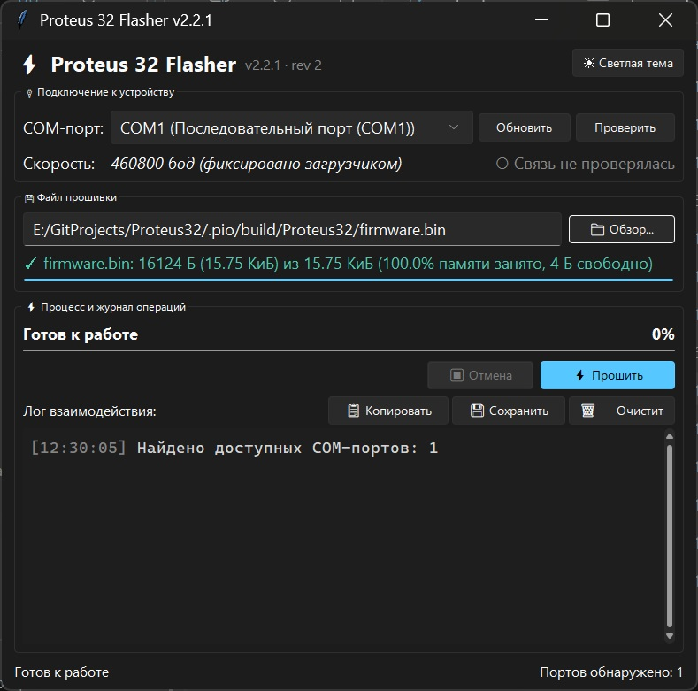

# BootUI — Proteus 32 Flasher (GUI & CLI)

[](LICENSE)

-success)


Графическая оболочка (**GUI**) и консольная утилита (**CLI**) для прошивки и диагностики микроконтроллеров **WCH CH32V003F4U6** через UART по протоколу загрузчика **[Proteus32-BootLoader (Revision 2)](https://github.com/tama18101971/Proteus32-BootLoader)**.

Оба инструмента используют единое ядро протокола (`proteus32_protocol.py`), обеспечивающее **гарантированную защиту области пользовательских настроек `WL_FLASH` (`0x08003F00–0x08003FFF`)** от случайного стирания или перезаписи.



---

## Содержание

1. [Ключевые возможности](#-ключевые-возможности)
2. [Структура репозитория](#-структура-репозитория)
3. [Установка и запуск](#-установка-и-запуск)
4. [Работа с графической оболочкой (GUI)](#-работа-с-графической-оболочкой-gui)
5. [Работа с консольной утилитой (CLI)](#-работа-с-консольной-утилитой-cli)
6. [Краткое описание протокола (Rev 2)](#-краткое-описание-протокола-rev-2)
7. [Сборка исполняемого файла (.exe) и тестирование](#-сборка-исполняемого-файла-exe-и-тестирование)

---

## Ключевые возможности

* **Современный интерфейс Windows 11 Fluent Design:** построен на базе `tkinter` и `sv-ttk`, автоматически определяет системную тему Windows (тёмная/светлая), синхронизирует цвет системного заголовка окна (DWM) и поддерживает масштабирование High-DPI.
* **Безопасность `WL_FLASH` (Protocol Probe):** перед любой операцией стирания или запуска выполняется неразрушающий опрос загрузчика командой `READ` (`0x84`). Если на плате установлен старый загрузчик `rev 1` (способный повредить настройки), операция блокируется с подробной подсказкой.
* **Строгий контроль размера прошивки:** визуальная шкала заполнения памяти проверяет, чтобы бинарный файл не превышал лимит области приложения **16 128 байт** (`15.75 КиБ`, диапазон `0x08000000–0x08003EFF`).
* **Полноценная побайтная верификация:** после записи блоков программа передаёт эталонный образ в команде `VERIFY` (`0x82`) и проверяет идентичность записанных во Flash данных.
* **Асинхронный движок:** все операции с COM-портом выполняются в отдельном рабочем потоке (`FlasherWorker`) — интерфейс не зависает, отображает прогресс по этапам, текущую скорость (`КиБ/с`) и позволяет безопасно отменить операцию в любой момент.
* **Цветной журнал операций:** лог с метками времени и подсветкой статусов (`INFO`, `OK`, `WARN`, `ERROR`), который можно скопировать в буфер обмена или сохранить в `.txt` файл.
* **Единый источник истины для протокола:** модуль `proteus32_protocol.py` объединяет формирование кадров, расчёт контрольных сумм, таймауты и политику повторов для GUI и CLI.

---

## Структура репозитория

| Файл / Каталог | Описание |
| :--- | :--- |
| `bootloader_gui.py` | Графическое приложение **Proteus 32 Flasher v2.2.1** (GUI на базе `tkinter` + `sv-ttk`). |
| `proteus32_3.py` | Консольный программатор и утилита диагностики **v2.1** (CLI: запись, очистка, дамп памяти, старт). |
| `proteus32_protocol.py` | Общий транспортный и протокольный модуль (Revision 2): сборка кадров, парсинг ответов, ретраи. |
| `build_exe.cmd` | Скрипт сборки автономного исполняемого файла `.exe` с помощью PyInstaller. |
| `tests/` | Набор модульных и сквозных автотестов (`pytest`) с эмуляцией COM-порта (`FakeSerial`) и проверкой векторов ТЗ. |
| `screenshot.jpg` | Скриншот главного окна программы. |

---

## Установка и запуск

### 1. Требования
* ОС: Windows 10 / 11 (также поддерживается запуск скриптов на Linux/macOS).
* Интерпретатор **Python 3.8+** (рекомендуется Python 3.10+). При установке на Windows обязательно отметьте галочку **"Add Python to PATH"**.

### 2. Установка зависимостей

Откройте терминал или командную строку (`cmd`) и выполните:

```bash
pip install pyserial sv-ttk tqdm
```

* `pyserial` — обмен данными через последовательный порт (COM-порт).
* `sv-ttk` — тема оформления Sun Valley (Windows 11 Fluent Design) для GUI.
* `tqdm` — отображение прогресс-бара в консольной утилите (опционально).

### 3. Запуск графической оболочки

```bash
python bootloader_gui.py
```

---

## Работа с графической оболочкой (GUI)

1. **Перевод устройства в режим загрузчика (IAP):**
   Зажмите кнопку на плате (вывод `PC3` к `GND`) и подайте питание. Красный светодиод (`PC7`) начнёт мигать с частотой ~4 Гц.
2. **Подключение к устройству:**
   * Выберите нужный **COM-порт** из выпадающего списка (если адаптер подключён только что — нажмите **«Обновить»**).
   * Скорость фиксирована загрузчиком и составляет **460800 бод**.
   * Нажмите **«Проверить»**, чтобы выполнить безопасный опрос устройства. При успешном ответе индикатор сменится на `● Загрузчик v2 на связи`.
3. **Выбор файла прошивки:**
   Нажмите **«Обзор...»** и укажите скомпилированный файл `.bin`. Программа проверит его размер и покажет процент заполнения доступной памяти (`15.75 КиБ`) и остаток свободных байт.
4. **Прошивка микроконтроллера:**
   Нажмите кнопку **«Прошить»**. Процесс пройдёт в 4 этапа:
   * `Этап [1/4]` — Проверка загрузчика (`READ` probe по адресу `0x08000000`).
   * `Этап [2/4]` — Очистка области приложения (`ERASE`, без затрагивания `WL_FLASH`).
   * `Этап [3/4]` — Постраничная запись блоков по 64 байта (`PROM`).
   * `Этап [4/4]` — Побайтная верификация записанных данных (`VERIFY`) и автоматический запуск программы (`END`).
5. **Управление журналом и темой:**
   В нижней части окна доступен подробный журнал операций с кнопками **«Копировать»**, **«Сохранить»** и **«Очистить»**. Переключение между тёмной и светлой темой выполняется кнопкой в правом верхнем углу.

---

## Работа с консольной утилитой (CLI)

Скрипт `proteus32_3.py` предназначен для работы из командной строки, автоматизации в CI/CD, интеграции в IDE (PlatformIO / MounRiver) и снятия дампов памяти.

```bash
# Полный цикл прошивки (проверка rev 2 -> стирание -> запись -> верификация -> запуск)
python proteus32_3.py COM5 firmware.bin

# Прошивка с пропуском этапа верификации
python proteus32_3.py COM5 firmware.bin --no-verify

# Только очистка области приложения (WL_FLASH остаётся нетронутой) и выход в приложение
python proteus32_3.py COM5 --erase-only

# Чтение (дамп) произвольного участка Flash в файл (выравнивание по 64 байта)
# Пример: сохранение резервной копии 256 байт настроек WL_FLASH
python proteus32_3.py COM5 --dump wl_settings.bin --addr 0x08003F00 --len 256

# Запуск основного приложения без перепрошивки (отправка команды END)
python proteus32_3.py COM5 --go

# Вывод версии утилиты и ревизии протокола
python proteus32_3.py --version
```

* Коды возврата: `0` — успешное выполнение, `1` — ошибка связи, верификации или аргументов.

---

## Краткое описание протокола (Rev 2)

Полная аппаратная спецификация приведена в репозитории **[Proteus32-BootLoader](https://github.com/tama18101971/Proteus32-BootLoader)**.

* **Физический уровень:** `USART1` (`PD5` = TX, `PD6` = RX), `460800 8N1`, полудуплексный режим **Stop-and-Wait**.
* **Формат кадра запроса:** `AA 55 <CMD> <LEN> [ADDR_STUB] [DATA] <CKL> <CKH> 55 AA` (контрольная сумма — 16-битная сумма всех байтов между `AA 55` и `55 AA` в формате Little-Endian).
* **Поддерживаемые команды:**
  * `0x80` (`PROM`) — запись 64 байт данных в область приложения `[0x08000000, 0x08003F00)`.
  * `0x81` (`ERASE`) — быстрое постраничное стирание 252 страниц области приложения (таймаут до 10 с).
  * `0x82` (`VERIFY`) — сверка 64 байт эталонных данных с содержимым Flash.
  * `0x83` (`END`) — сброс сессии и перезагрузка МК в пользовательское приложение.
  * `0x84` (`READ`) — чтение 64-байтной страницы из любого участка пользовательского Flash `[0x08000000, 0x08004000)`.
* **Коды статуса в базовом ответе (`AA 55 00 ST 55 AA`):**
  * `0x00` (`ST_OK`) — успешно.
  * `0x01` (`ST_ERR`) — ошибка выполнения команды.
  * `0x02` (`ST_ERR_RANGE`) — нарушение границ области приложения (защита `WL_FLASH`).
  * `0x03` (`ST_ERR_VERIFY`) — несовпадение данных при верификации.

---

## Сборка исполняемого файла (.exe) и тестирование

### Сборка автономного `.exe`

Для создания однофайловой сборки Windows (не требующей установленного Python на целевом ПК) установите `pyinstaller` и запустите пакетный файл:

```cmd
pip install pyinstaller pyserial sv-ttk
build_exe.cmd
```

Готовый исполняемый файл появится в каталоге `dist\`.

### Запуск автотестов

В репозитории предусмотрен набор тестов `pytest`, проверяющий побайтное совпадение всех контрольных векторов протокола, обработку фрагментированных пакетов, таймауты и синхронизацию между GUI и CLI:

```bash
pip install pytest
pytest -v
```